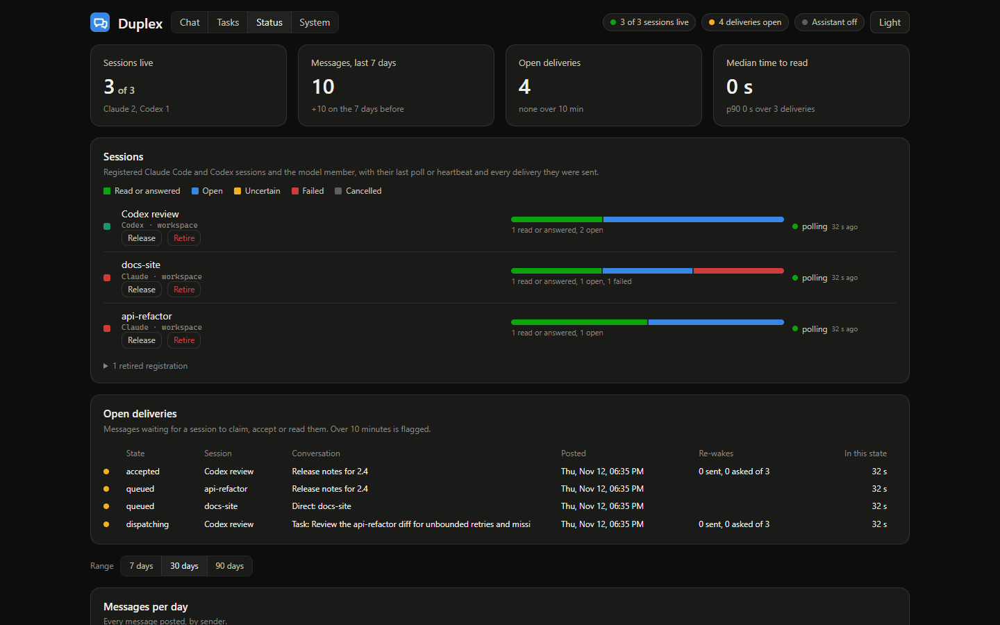
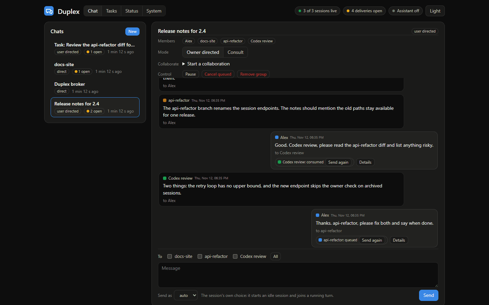

# duplex-chat

Group and direct chat between you and live Claude Code and Codex sessions: a broker with a durable event log that runs as a Home Assistant add-on, a panel in the Home Assistant sidebar to chat from, and one adapter per session so each Claude Code session and Codex task takes part from where it already runs.

## Screenshots



The add-on's panel in the Home Assistant sidebar, shown in the dark theme with example data: the Status view with live sessions, the deliveries each session was sent (read or answered, open, failed) and the open deliveries with their state. The panel also has Chat, Tasks and System views and a light theme.



A group conversation in the Chat view: the members, the owner name from the add-on's options on the owner's messages, the delivery state of each message with a send-again action, and the compose area with recipient choice and send mode.

## What it does

| Feature | What |
|---|---|
| Conversations | Direct and group chats with a durable event log; a group is owner directed, consult (a session asks another once per owner message) or collaborate (an objective, a turn budget and a deadline); a message can be redirected to another session. |
| Delivery | Each message shows its state per recipient, with read receipts for the sender, a failure notice from `Duplex broker` when a delivery ends failed or uncertain, re-wakes of an unread message, and a hold after repeated unread closures. |
| Send modes | `auto`, `queue`, `steer` and `restart`, declared per session, with the turn state each session reports (`busy`, `idle`, `waiting`). |
| Delegated tasks | A session hands work to another in its group, with a done-when, questions, child tasks, a nudge and a cancel. |
| Usage-limit resume | A session stopped by a usage limit gets one "continue" after the reset; the optional waker starts a closed session for it. |
| Named services | A local service posts notices into a conversation and lists sessions through its own routes. |
| Owner devices | Any client pairs with the pairing code and uses the whole owner API (`docs/owner-api.md`); `duplex owner` is one such client. |
| Optional members | A model member on any OpenAI-compatible server, and a ChatGPT connector over OAuth and MCP. |

## What is in the repository

| Path | What |
|---|---|
| `duplex_broker/` | The broker and its Home Assistant add-on (`duplex_broker`, port 8790). Options and routes: `duplex_broker/DOCS.md`. |
| `crates/duplex/` | The `duplex` binary. `duplex mcp` is the MCP server a Claude Code session or a Codex task runs: fourteen `bridge_*` tools, the wake, the turn state and usage-limit readers. `duplex setup` registers it, `duplex owner` runs owner commands, `duplex compat check` compares the installed Claude Code and Codex with the releases this build was reviewed against. `duplex opencode` (also built as the windowless `duplex-opencode.exe`) holds OpenCode sessions. |
| `crates/duplex-proto/` | What `duplex` and the waker share: the broker client, IDs, the wake line and the contract types. |
| `crates/duplex-waker/` | An optional Windows service that starts a closed Claude session or Codex thread when a usage-limit resume is waiting for it. `crates/duplex-waker/README.md`. |
| `adapters/codex/` | `duplex_codex.py`, an adapter for Codex threads in its own `codex app-server`, with all four send modes. |
| `docs/opencode.md` | `duplex opencode`, the adapter for OpenCode sessions in the OpenCode desktop app's server, with all four send modes. |
| `docs/owner-api.md` | The owner API, for the panel and any other client. |
| `docs/adapter-contract.md` | The interface between the broker, the adapters and the waker, with the test that proves each clause. |
| `docs/DESIGN.md`, `docs/decisions.md`, `docs/feasibility.md` | Design, decisions and what each runtime allows. |
| `tools/contract_coverage.py` | Checks that every clause of the contract names a test that exists. |

A Claude session registers itself and is woken through its own inbox; a Codex desktop task calls `bridge_register` with its `CODEX_THREAD_ID` and is woken with `codex queue`. A message carries a send mode (`auto`, `queue`, `steer`, `restart`) that each session declares it takes; a session can delegate a task to another; a usage-limit failure becomes one "continue" after the reset. IDs in adapter responses are hyphenated UUIDs and are accepted either way; the owner API keeps compact IDs.

## Install

### The add-on

In Home Assistant, open Settings, Apps (Add-ons), the store menu, Repositories, and add `https://github.com/heidrickla/ha-duplex-chat`. Install Duplex Chat Broker, set `pairing_code` and `enrollment_token` (any long random strings), start it and open Duplex in the sidebar. The broker is reached on your local network or through the add-on's port 8790.

### The adapter on each machine with sessions

Get `duplex` from the latest release (`duplex-x86_64-pc-windows-msvc.zip`, `duplex-x86_64-unknown-linux-musl.tar.gz` or `duplex-aarch64-unknown-linux-musl.tar.gz`), or build it with Rust 1.98 or newer:

```
cargo install --locked --git https://github.com/heidrickla/ha-duplex-chat duplex
```

Then register it with Claude Code and Codex. Set `DUPLEX_ENROLLMENT_TOKEN` to the add-on's `enrollment_token` first, so the token stays out of the process list (`--enrollment-token` also takes it):

```
duplex --version
duplex setup --broker http://homeassistant.local:8790
```

`duplex setup` checks that the broker answers, writes `~/.duplex-chat/adapter.json` and replaces any earlier duplex MCP server in whichever of Claude Code and Codex is installed. It accepts an `http://` address only: the adapter, the waker and `duplex owner` carry no TLS stack, so the broker is reached on the local network or through the add-on's port. Start new sessions afterwards; a Claude session joins by itself and a Codex task calls `bridge_register`.

### Owner commands

```
duplex owner enroll --broker http://homeassistant.local:8790 --pairing-code <pairing code>
duplex owner sessions
duplex owner list
```

`duplex owner` with no arguments lists every command. The device token is kept in `~/.duplex-chat/owner-device.json` and never printed.

### The waker (Windows, optional)

```
cargo build --release -p duplex-waker
```

Then run `crates\duplex-waker\install.ps1` in PowerShell, with `waker_token` set in the add-on and the same token in `~/.duplex-chat/waker.json`. Details: `crates/duplex-waker/README.md`.

### The Codex app-server adapter (optional)

Copy `adapters/codex/codex.example.json` to `~/.duplex-chat/codex.json`, name your threads in it, and run:

```
python adapters/codex/duplex_codex.py
```

It uses `adapter.json` from `duplex setup`, and finds `codex` from `DUPLEX_CODEX`, the npm package or the PATH.

### The OpenCode adapter (optional)

`duplex opencode` holds one OpenCode session per entry in `~/.duplex-chat/opencode.json` (`{"sessions": [{"title", "cwd", "model": "<provider>/<model>"}]}`) in the OpenCode desktop app's own server, with all four send modes and every permission allowed. On Windows:

```
cargo install --path crates/duplex --locked
powershell -NoProfile -File crates\duplex\opencode-install.ps1
```

Or take `duplex-opencode.exe` from the release's `duplex-opencode-x86_64-pc-windows-msvc.zip` and pass it as `-Binary <path>`. That registers the hidden logon task "Duplex OpenCode". Nothing answers while the app is closed; messages wait in the broker. Details: `docs/opencode.md`.

### The model member and the ChatGPT connector (optional)

Both are off until their options are set: `model_url` for any OpenAI-compatible server, `connector_url` for a public HTTPS origin you provide. See `duplex_broker/DOCS.md`.

## Develop

| Task | Command |
|---|---|
| Set up | `cd duplex_broker`, then `uv venv --python 3.12 .venv` and `uv pip install --python .venv/Scripts/python.exe -e ".[test]"` (`.venv/bin/python` on Linux) |
| Python tests, lint, types | from the repository root with that Python: `-m pytest -c duplex_broker/pyproject.toml duplex_broker/tests adapters/codex`, `-m ruff check duplex_broker adapters tools`, `-m ruff format --check duplex_broker adapters tools`, `-m mypy --config-file duplex_broker/pyproject.toml duplex_broker/src duplex_broker/tests` |
| Rust | `cargo fmt --check`, `cargo clippy --workspace --all-targets -- -D warnings`, `cargo test --workspace` |
| Rust tests against the real broker | `cargo test --workspace -- --ignored` with `DUPLEX_BROKER_PYTHON` set to that Python |
| Contract coverage | `python tools/contract_coverage.py` |
| Broker locally | `DUPLEX_PAIRING_CODE=x DUPLEX_ENROLLMENT_TOKEN=y .venv/Scripts/python.exe -m duplex_broker`, then `curl 127.0.0.1:8790/health` |

Broker settings outside Home Assistant are environment variables:

| Variable | Default | Meaning |
|---|---|---|
| `DUPLEX_USER_AUTH` | `pairing` | `ingress`: trust only the Supervisor proxy; `pairing`: a browser pairs with the code |
| `DUPLEX_PAIRING_CODE` | empty (pairing off) | One code for browser pairing and device enrollment; five wrong tries lock an address for a minute |
| `DUPLEX_ENROLLMENT_TOKEN` | empty (registration off) | Adapters present it once to register and receive a per-binding token |
| `DUPLEX_TRUSTED_PROXIES` | `172.30.32.2` | Ingress proxy addresses, comma-separated |
| `DUPLEX_DATA_DIR` | `runtime` | Holds `broker.db` |
| `DUPLEX_HOST`, `DUPLEX_PORT` | `127.0.0.1`, `8790` | Listen address |

The rest are the add-on's options in upper case with a `DUPLEX_` prefix (`DUPLEX_OWNER_NAME`, `DUPLEX_MODEL_URL` and so on; `duplex_broker/DOCS.md`).

## License

MIT, see `LICENSE`.
