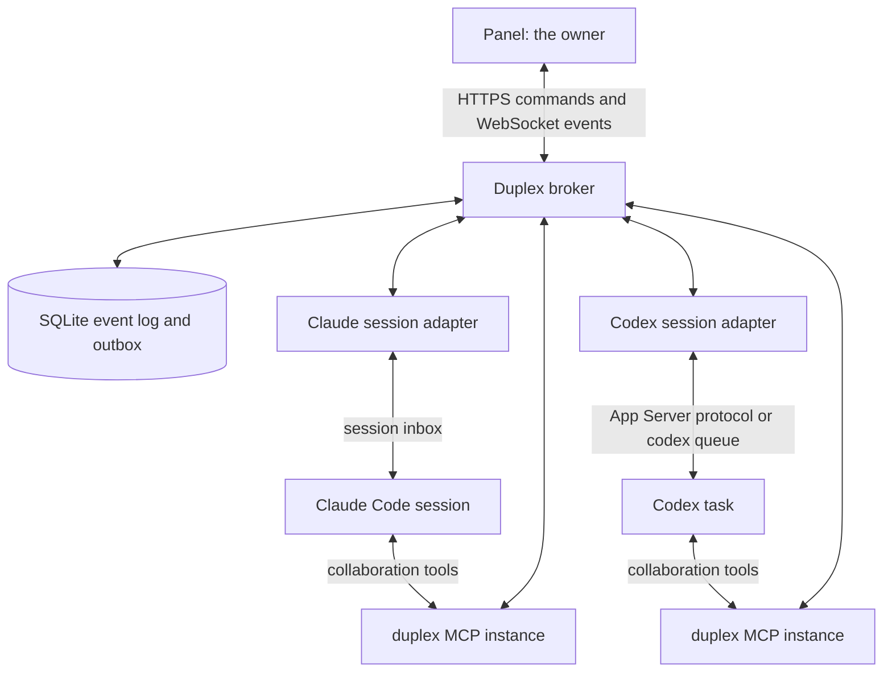

# Claude–Codex duplex chat

Design: architecture, routing and trust, storage, protocol and acceptance gates.

## Approach

A shared group chat plus separate direct conversations between the owner and individual sessions. A persistent broker owns message routing and history. Small adapters connect the broker to each agent's actual session. The browser receives live events over WebSocket. An MCP server in each session (`duplex mcp`) carries the collaboration tools that call the broker.

Existing sessions and sessions started by the bridge are both supported. The connection type is visible: connecting to a live process, resuming saved history, and creating a new conversation are different operations. A resumed conversation is not labeled as attached to the original running process.

The owner can message an individual session outside the group. Routing is user-directed by default; a group holds Claude and Codex sessions alongside independent direct conversations; automatic collaboration is bounded and only in groups. The interface is text; voice and remote hosting are later work.

## Experience

- Pick the Claude session and Codex task by title, workspace, and connection state. Show native IDs in connection details, not as primary labels.
- In a group, address Claude, Codex, or both. Targeting only Claude inside the group still creates a group-visible message. Broadcast creates two separately tracked deliveries.
- Open **Direct messages → session title** for a separate conversation with that session. No group membership is required. Keep its messages, replies, drafts, unread count, attachments, and approvals separate from the group.
- See a chronological history per conversation, streamed responses where supported, queued-message states, concise tool activity, and approval cards.
- Ask one agent to consult the other in the group. Direct conversations never auto-forward to a peer, even when group collaboration is active.
- Queue input during a busy turn. Offer **Steer** or **Interrupt** only for adapters that support them. Interrupting a turn does not undo its tools' effects.
- **Pause collaboration** stops new automatic agent-to-agent delivery in the group. **Stop conversation** affects only work originating in the selected conversation. Session-wide interruption is a separate control; neither silently terminates unrelated processes.
- Reconnect the browser without losing conversation or resubmitting prompts. Show disconnected and delivery-uncertain states explicitly.
- Preserve the agents' workspace instructions, tools, model choices, permission boundaries, and account configuration.

## Architecture



| Component | Responsibility | Implementation |
|---|---|---|
| Panel | Conversation navigation, session selection, composer with a send mode, delivery states, tasks | One HTML page the broker serves, on the owner API |
| Broker | Authentication, conversation membership, ordered events, outbox, delivery, budgets | Python ASGI service; FastAPI, one worker |
| Database | Durable messages, receipts, session bindings, replay cursors | SQLite WAL on local disk |
| Claude and Codex task adapter | Registration, claim, wake, turn state, usage limits, replies | The `duplex` binary (`crates/duplex`): the adapter and its MCP server in one process per session |
| Codex app-server adapter | Native thread IDs, turns, streamed items, interruption | `adapters/codex/duplex_codex.py`: JSON-RPC over the stdio of its own `codex app-server` |
| Collaboration tools | Agent send/receive/status operations | The fourteen `bridge_*` tools of `duplex mcp`, backed by the broker's adapter API |

Run the broker independently from the MCP processes: each stdio MCP client has its own process and session state. An in-memory queue inside one MCP instance cannot connect both agents, so the broker is the cross-agent conversation store.

Use one authoritative broker writer and per-session dispatch lock. Do not add Redis, a distributed queue, or Kubernetes for a two-session desktop application. Revisit PostgreSQL and host workers only when multiple hosts/users are required.

## Direct conversations

A conversation has `kind: group | direct`. A direct conversation has exactly the owner and one specific session binding as members, not every session belonging to that provider. Opening a DM reuses that binding and native session; it does not spawn a replacement model or create a second controller. The same binding may participate in several conversations. A session may also have a DM without participating in any group.

The sidebar separates Groups from Direct messages. The active header and composer always show the selected conversation and recipient. Direct conversations lock the recipient to that session and hide peer-consultation controls. Switching views preserves separate drafts; arriving background replies increment that conversation's unread count without changing the selected view.

Direct messages and their replies are excluded from group events, peer inboxes, group summaries, exports, search, attachments, and replay. Every read, subscription, delivery, and artifact download checks conversation membership. An agent cannot choose a group as the destination for a reply to a direct message. If the owner wants to share something, they copy it into a new group message; the broker never exposes the DM history to the group.

This is routing and history separation, not model-context isolation: the same native session may remember both its group and direct turns, and later generated text could draw on that context. Label the UI **Direct · same session context**. Do not promise that the model can never mention private information later. For independent context, offer an explicitly separate session without copying the DM, clearly labeled as a different session. Shared files and permitted tools remain shared unless their access is separately isolated.

### Concurrent group and direct activity

- Serialize dispatch across all conversations targeting the same native session. Do not use separate per-conversation locks that allow two turns to write one session simultaneously.
- Record immutable `(conversation_id, message_id, binding_id, native_turn_id)` ownership when dispatching. Route every delta, final reply, tool event, artifact, and approval using that ownership, never the currently selected tab or latest inbound message.
- A DM arriving during a group turn queues for the next turn boundary. Do not steer private text into an active group turn. Steering is allowed only within that turn's originating conversation.
- Channel implementations must preserve reply correlation and must defer private delivery while a group turn is active. If the adapter cannot verify turn boundaries and reply ownership, disable mixed group/DM use for that binding or offer a separate session; a promise in the model prompt is insufficient.
- A reply without verifiable ownership is held for reconciliation in a restricted owner-only view. It is never broadcast to the group as a fallback.
- Conversation-scoped stop cancels that conversation's pending deliveries and interrupts only active turns owned by it. Session-wide stop is a separate explicit control because it may affect other conversations.

## Session adapters and limitations

### Codex

Installed CLI observed: `0.155.1`. Locally generated schema includes `thread/list`, `thread/read`, `thread/loaded/list`, `thread/resume`, `turn/start`, `turn/steer`, and `turn/interrupt`. The CLI exposes App Server stdio, WebSocket, and a proxy to a daemon control socket. These observations establish available interfaces, not attachment to this desktop task.

Use a controlled App Server for bridge-managed tasks. For existing tasks, first establish a supported connection to their owning App Server and verify live event subscription. Do not start a second writer against the same task history. If the desktop's owning endpoint is unavailable, present **Resume after handoff** or **Observe only**, with the reason. The Codex-app tools visible inside this conversation are not assumed to be a public HTTP API available to the new web application.

Initialize once per protocol connection. Preserve the returned native task/turn/item identities. Use `turn/steer` with `expectedTurnId`; reject stale-turn requests. Handle approval requests on their originating connection. Bind generated schemas to the tested runtime version. See the [official App Server reference](https://developers.openai.com/codex/app-server/).

### Claude

Installed Claude Code observed: `2.1.281`. Its CLI exposes streamed JSON input/output, saved-session resume, background sessions, and terminal attach. Terminal attach alone is not evidence of a supported web protocol.

Existing sessions, including the desktop app's, are reached through Claude Code's cross-session messaging: each session has an inbox (a named pipe on Windows, a Unix socket elsewhere) whose address and token it gives its child processes, and the `duplex` MCP server in the session posts one fixed wake line into it. Message text reaches the model only as a `bridge_receive` tool result. Channels were measured and rejected as the adapter: a custom channel needs an interactive terminal launch with a development flag, which desktop sessions never pass (`feasibility.md`). [Cross-session messaging](https://code.claude.com/docs/en/cross-session-messaging).

The adapter advertises message-level output only. A session reply is its own `bridge_send` call; there is no token stream and no mirror of terminal activity. Remote Control is documented for Claude's own web and mobile clients, and the design does not assume its service is an API for another client.

### Capability handshake

Each binding declares `receive_messages`, `publish_replies`, `stream_text`, `observe_activity`, `steer`, `interrupt`, `relay_approvals`, `resume_history`, and `attach_live`. Values are `verified`, `unsupported`, or `unverified`, with runtime version and last verification time. The UI enables controls only for verified capabilities. On a version change, invalidate the affected claims and run the adapter compatibility checks.

No automatic process termination or duplicate resume on attach failure. A registry file, PID, or old transcript establishes a candidate session only. Bind an endpoint, native session identity, process start identity, workspace, and broker-issued lease generation together; validate liveness before delivery.

## Routing and trust

Modes:

| Mode | Behavior |
|---|---|
| User-directed, default | The owner chooses recipients in a group; a DM has one fixed session recipient. Replies return to the originating conversation. |
| Consult, group only | The owner authorizes a peer consultation. The initiating agent can send a question; one peer response returns to the initiator. |
| Collaborate, group only | The owner starts a bounded exchange with an objective, a time limit, and a turn limit. |

Collaboration defaults: six agent-generated turns (at most 12) and ten minutes (at most 60). It stops on completion, owner pause, a mode change, or the first exhausted limit. Agents cannot raise budgets or enroll new participants.

Route explicit messages, not every transcript line. Never relay token deltas, tool output, or status events as new peer prompts. Preserve `origin_message_id`, `in_reply_to`, and a broker-maintained causal chain. Suppress reflected duplicates and cap relay depth. A peer response with no authorized next recipient ends the exchange.

Peer output is attributed external data, not a new instruction from the owner. Actor identity comes from the authenticated adapter binding, never a submitted `sender` field. Prefer delivering peer content through `bridge_receive` tool results. Where a wake-up is needed, send a fixed, previously user-authorized instruction to check the inbox; do not copy peer prose into a user-authority prompt. If the recipient cannot support that safely, queue it for a manual user handoff. Agent messages can never grant permissions or impersonate approval decisions.

## Storage and protocol

| Table | Essential fields and constraints |
|---|---|
| `conversations` | ID, kind `group` or `direct`, title, owner, mode, policy version, budget, paused state; direct mode excludes peer relay |
| `session_bindings` | participant, provider, native ID, workspace, endpoint reference, capabilities, heartbeat, lease generation; one active controlling binding per native session, independent of conversation membership |
| `conversation_members` | conversation, user or binding, role; a DM has exactly its owner and one binding; unique active DM per `(owner, binding)` |
| `messages` | ID, conversation, actor, text, recipients, causal parent, timestamp; unique `(actor, client_message_id)`; retries with different content or conversation are rejected |
| `events` | conversation, monotonic conversation sequence, event ID, type, message/turn/item references, payload; append-only |
| `deliveries` | message, recipient binding, state, attempt, native acceptance IDs, lease generation; unique `(message, recipient)` |
| `approvals` | conversation, originating message/turn, binding, originating connection generation, native request ID, action details, status, expiry, deciding user |
| `artifacts` | conversation, originating message/turn, opaque ID, checked local path, MIME type, size, producer; no arbitrary-path downloads |

Browser submission example; this is our proposed protocol, not a provider method:

```json
{
  "type": "message.send",
  "client_message_id": "browser-generated-uuid",
  "conversation_id": "example-group",
  "recipients": ["claude", "codex"],
  "content": {"format": "text", "text": "Compare the proposed deployment steps."},
  "busy_policy": "queue"
}
```

For a DM, send its `conversation_id`; the broker derives the sole session recipient from membership and rejects conflicting recipients. The client cannot change a DM into a group by adding another recipient.

Server events carry `event_id`, `conversation_id`, `seq`, `type`, `timestamp`, `actor`, `message_id`, and optional native `turn_id`/`item_id`. Event types include `message.accepted`, `delivery.changed`, `reply.delta`, `reply.completed`, `session.changed`, `approval.requested`, `approval.resolved`, `collaboration.paused`, and `error`. Treat final text as the canonical item snapshot so reconnects cannot append a completed reply twice.

| Interface | Contract |
|---|---|
| `POST /api/conversations` | Create a group and bounded policy |
| `POST /api/direct-conversations` | Open or return the owner's DM with an authorized session binding; no group required |
| `GET /api/sessions` | Return authorized candidate sessions and capabilities; discovery is not attachment |
| `POST /api/bindings` | Explicitly attach, resume, or create once; return actual mode or typed unsupported result |
| `POST /api/conversations/{id}/members` | Add an authorized binding to a group; DM membership is fixed |
| `POST /api/conversations/{id}/messages` | Persist message and deliveries atomically; idempotency key required |
| `GET /api/conversations/{id}/events?after=N` | Replay authorized, ordered durable events for this conversation |
| `WS /api/events` | Authenticated live events; authorize each conversation subscription and cursor |
| `POST /api/conversations/{id}/control` | Queue, steer, or interrupt only this conversation's turns; check capability and lease generation |
| `POST /api/bindings/{id}/control` | Explicit session-wide interrupt or detach; show effects on other conversations |
| `POST /api/approvals/{id}/decision` | Human-only scoped allow/deny; reject stale or duplicate decisions |
| `POST /api/conversations/{id}/collaboration` | Group-only, human-only start/pause/stop and budget changes |

MCP tools (`duplex mcp`, fourteen in all): `bridge_status`, `bridge_send`, `bridge_receive`, `bridge_members`, `bridge_history`, `bridge_message` and `bridge_register` carry messages, and the seven `bridge_task_*` tools handle delegated work. Callers are restricted to their conversation memberships and permitted recipients. Replies are bound to the originating delivery; a different conversation, a group destination for a DM reply, or a peer recipient from a DM is refused. Browser authentication, approval decisions and arbitrary session control are not agent tools.

## Delivery and recovery

Persist the message and recipient outbox rows before acknowledging the browser. Dispatch each session's messages in order across group and direct conversations. Maintain a sequence per conversation for display, without claiming that independent agents execute in that same order.

Delivery states: `queued -> dispatching -> accepted -> consumed -> responded`. Terminal alternatives: `cancelled`, `failed`, or `uncertain`. Native protocol acknowledgement can establish accepted; consumed requires an explicit bridge receipt or equivalent evidence. Missing receipts remain unknown. Never infer reading from a socket write or a green presence indicator.

A crash after provider acceptance but before recording that acceptance is ambiguous. Reconcile native turn/item identity where supported; otherwise mark uncertain and require a deliberate resend. Do not blindly retry an action-bearing prompt. Delivery is at-least-once only where recipient deduplication is proven; the design makes no universal exactly-once execution claim.

Reconnect with exponential backoff and jitter. Browser replay starts after its last durable cursor. Persist message boundaries and terminal events; optionally coalesce text deltas every 50 ms. On replay truncation, return a snapshot plus its cursor. Slow clients get a reconnect/snapshot requirement, not silent loss of completed messages. Keep a bounded queue per recipient and return an explicit full-queue error.

Approval requests remain scoped to the original session, connection generation, and action. Detach, timeout, or provider restart invalidates unresolved requests unless the provider supports reconciliation. Only the owner's authenticated decision can resolve one. A denied action is not retried through the other agent.

Broker restart does not imply it should restart agents. Adopt a still-running managed process only through a verified reconnect path; otherwise report disconnected and reconcile before resuming. Cancellation records what stopped and what may already have executed.

## Access and deployment

The broker runs as a Home Assistant add-on and the adapters connect outbound from the machines that host the sessions. The browser reaches the panel through Home Assistant ingress, or outside it by a one-time pairing code that sets a scoped HttpOnly session cookie; writes carry a CSRF token. Adapter connections authenticate separately, with a credential scoped to a binding. Raw App Server and arbitrary-shell endpoints are never exposed to the browser.

An agent with shell access under the same OS account can potentially read user-owned broker files; tokens alone do not create a hostile-agent isolation boundary. The broker protects routing and accidental cross-session access, while existing runtime sandboxes and human approvals remain authoritative. Stronger isolation would require separate host identities and a different deployment design.

For access from other devices, put the web service behind an authenticated TLS access layer you provide. Workers stay near the sessions and connect outbound. Rehosting the broker cannot move a live desktop session.

Store conversation data under an ignored local runtime directory with restricted filesystem access and an explicit retention setting. Provider credentials stay in their existing runtimes. Persist normalized chat and requested activity only, not hidden reasoning or a wholesale copy of both transcript directories. Escape model-generated HTML; serve attachments by authorized opaque ID, with size/type limits and no symlink escape.

## Performance targets

Design targets, not measurements: two active agents, up to four browser clients; local persisted-message acknowledgement p95 under 200 ms; provider-event-to-browser p95 under 250 ms; 64 KiB maximum chat message; 100 queued deliveries per session. Model generation time is separate. Track queue depth, acceptance latency, reconnects, uncertain deliveries, pending approvals, dropped transient deltas, and budget stops.

## Build sequence and acceptance gates

| Stage | Output | Required proof |
|---|---|---|
| 1. Adapter feasibility | Native protocol probes and compatibility manifest | Existing Claude receives a unique nonce through its inbox wake and replies through `bridge_send`; existing Codex owning endpoint subscribes and replies without another writer; record unsupported cases |
| 2. Broker and UI | Durable group and direct conversations, mock adapters, replay | Independent drafts/history/unread state; two browsers see same per-conversation order; reconnect never resends input; negative recipient/auth tests |
| 3. Real connections | Group plus DMs to individual Claude and Codex sessions | Owner-to-each, broadcast, Claude-to-Codex, Codex-to-Claude; standalone DM without group; correct recipient and causal IDs; no unauthorized relay |
| 4. Controls | Queue, steer, interrupt, approval relay | Busy and stale-turn races; genuine pending approval answered once by the owner; agent attempt to approve rejected |
| 5. Recovery | Durable outbox, reconnect, adoption rules | Kill broker before/after acceptance, drop WebSocket, restart one adapter; no silent duplicate prompts; ambiguous delivery visibly uncertain |
| 6. Optional collaboration | Bounded automatic exchange | Stop at configured limit; reflection loop suppressed; user pause wins races; peer data cannot become user approval |

Additional release gates: existing terminals remain usable where co-control is promised; concurrent owners are refused; denied actions cannot be laundered through the peer; normal permissions remain enabled; provider login expiry becomes an actionable status. Real fixtures must include partial replies, tool errors, rate limits, and turn completion after a cancellation request.

Direct-message gates: send unique markers into each DM and assert their absence from the broker's group stream, group replay/export/search, and other agent's inbox; reject forged recipients and cross-conversation reply IDs. Switch views during streaming and reconnect mid-reply: output must remain in the originating conversation. Queue a DM during a group turn and prove dispatch waits for its boundary without a second native session. Verify private approvals and artifacts stay scoped. Test identical-provider sessions separately. These checks prove broker routing isolation, not that a shared model context can never disclose content in a later response.

A managed Codex session is the baseline: where live Codex desktop attachment is not supported, the capability stays marked unsupported rather than claimed.

## Evidence

The Codex schema is generated with `codex app-server generate-json-schema`, and the Claude and Codex versions are checked directly. Native live attachment, authentication and permission behavior are implementation feasibility gates, recorded in `feasibility.md`, not assumed capabilities.
